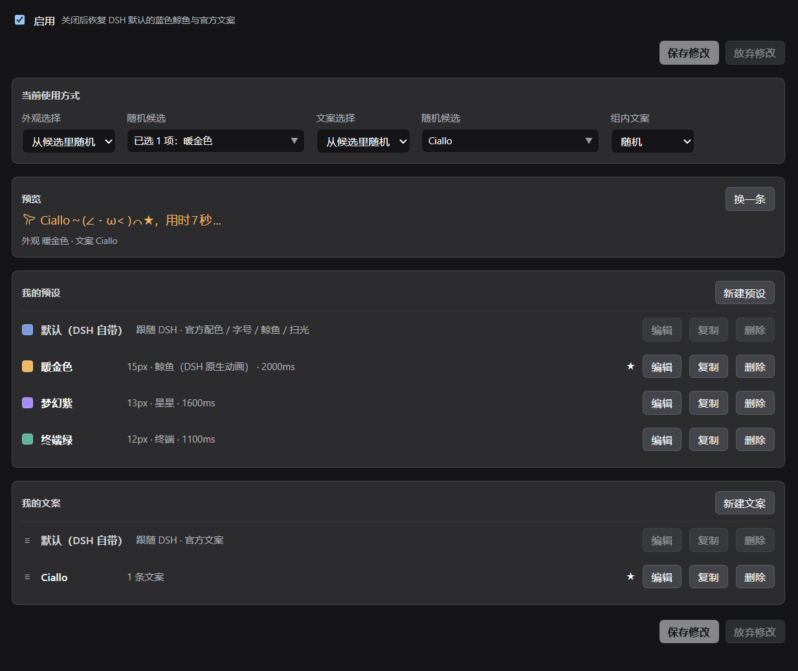

# dsh-status-flair

[中文](README.md) | English

A DeepSeek Harness (DSH) **web** plugin for restyling the chat's running status row.

Turn "Deep diving for 7s ···" into whatever you like: copy, colour, size, icon and shimmer speed.

No chat component is rewritten and the DSH installation directory is untouched: the look comes from injected CSS, the copy from one wrapper around `LocaleRuntime#translate`.

## What it changes

| Layer | Official source (DSH 0.2.1-rc.2) | What this plugin does |
|---|---|---|
| Copy | `chat.deepDiving` / `chat.deepDivingFor` from `@deepseek-ai/dsh-client-ui-chat` | Wraps `locale.translate` and intercepts only those two keys |
| Colour | `.running` → `color: var(--dsw-alias-label-deep-diving)` | Re-sets the colour and `--dsw-alias-label-shimmer` on `[data-chat-running]` |
| Size | `.running` → `font-size: calc(var(--dsh-content-font-size) - 2px)` | Overrides `font-size`; the icon size follows it |
| Icon | 60-frame APNG used as a `mask` (3 s loop) plus a static SVG fallback | Hides both layers and paints the preset icon with a mask on the container (built-in SVG / official APNG / custom SVG·PNG) |
| Shimmer | `_dsh-row-shimmer-*` keyframes from `TextShimmer` (1.5 s, `steps(48)`, .3 s delay) | Overrides `animation-duration` / `play-state`; 0 ms turns it off |

Selectors use stable hooks only: `[data-chat-running]`, `[data-shimmer]`, `:has(> [data-shimmer])`. Build-time hashed class names (`xz4KEq_`, `_1rdzk_`) are never used.

## Two layers

- **Look preset**: colour, size, icon, shimmer. It never stores "is it random".
- **Text preset**: a named group of candidate lines. It never stores a selection strategy either.
- **Selection**:
  - Look: one fixed preset, or a random draw from the candidates;
  - Copy: first fix or randomly draw a **group**, then take one line inside it by "always the first / random / rotate in order".

So "random look + random copy" does not conflict: each run draws a look, then a text group, then a line; the three random sources are independent. Splitting the copy randomness into two layers is the core of this design.

**Random timing**: the draw happens once when a new thinking run starts and stays fixed for that run. When the running row disappears the run is over and the next one draws again, so the copy never changes mid-run.

## Default means "take DSH's own"

Looks and copy each have a `default` entry (shown as "Default (DSH)" in the UI).

- With the default look, the plugin **sets no CSS variable and removes its `<html>` marker**, so DSH renders the running row itself.
- With the default copy, `translate` passes through and DSH's own `chat.deepDivingFor` is shown.
- This id is not a stored preset; the plugin never copies the official colour/size/whale/copy, so DSH upgrades flow through automatically.
- The settings preview reads `--dsw-alias-label-deep-diving`, `--dsh-content-font-size` and the official locale strings live; the default look preview also pulls the official whale mask (APNG data URL) out of the stylesheets DSH injected, animation included.
- **The shipped configuration contains the three look presets only, no text groups**: on first run the copy comes from DSH's official running row. Create a text group when you want custom copy.

## Details

- **Multi-select candidates**: random candidates are a checkable dropdown (fixed-positioned, so cards cannot clip it) with an "All" summary and select-all; unchecking the last item is blocked so there is never a zero-candidate state.
- **The ★ in the preview**: ★ marks the row the current preview actually sampled (one for the look, one for the copy); it re-samples when the selection changes, so it no longer drifts from what is displayed. Fixed mode shows a separate "Fixed" badge.
- **Custom icons**: six built-in SVGs, plus paste `<svg>…</svg>` or upload an SVG / transparent PNG. The icon is used as a mask (only its alpha shape is taken) and follows the preset colour; uploaded markup is stripped of scripts, event attributes and external references.
- **Whale icon**: the icon dropdown includes "Whale (DSH animation)". Nothing is copied: at runtime the plugin pulls the official APNG mask out of the stylesheets DSH injected. Colour and size follow the preset and the text shimmer stays under "Shimmer". The whale's own swing speed is baked into the APNG and cannot be changed by CSS; upload your own APNG (named `.png`) or an SVG to change the animation.
- **In-page draft**: every adjustment lands in a draft and applies live to the running row and preview; only **Save changes** writes the configuration. **Discard changes**, or leaving the page, reverts an unsaved draft. Save buttons sit at the top and the bottom, and the status line has a fixed slot, so the page never jumps.
- **Default rows keep disabled buttons**: the three buttons on a default row are shown but greyed out, which keeps the ★ and badges aligned with the custom rows.

## Placeholders

Inside copy you can use DSH's native template syntax:

- `{duration}` — replaced with the elapsed time DSH computed (`7s` / `7秒`, following the UI language);
- any other `{name}` is left as-is.

Example: `Deep diving {duration}` → "Deep diving 7s", updated every second.

## Languages

The plugin ships both `zh` and `en` dictionaries and follows the DSH language setting. The shipped preset names (Warm gold / Violet dream / Terminal green), icon labels and the default line for a new text group are translated; names you rename yourself are kept exactly as typed and are never translated over.

## Where to configure

**Plugins → this plugin's page** (Settings → Plugins → Status flair). The panel renders directly on the plugin page:

- enable switch, the two look/copy strategy layers (with multi-select candidates), live preview;
- create / edit / duplicate / delete for looks and text groups;
- **Save changes / Discard changes** at the top and the bottom.

Writes go through `ctx.configForms` (the volatile configuration channel); a failed save is shown explicitly.



## Install

> Installing changes the profile configuration under `%USERPROFILE%\.dsh` and requires restarting DSH (which interrupts running sessions). Please confirm first.

Repository: <https://github.com/AkotaP/dsh-status-flair>

**From the Plugins page**: sidebar **Plugins** → **Add plugin**, and enter the repository address `https://github.com/AkotaP/dsh-status-flair` (the same field also accepts an absolute local directory path or a tarball; once published to npm, the package name `dsh-status-flair` works too). DSH probes the repository with `git ls-remote` before handing it to pnpm; once installed, confirm it shows as enabled in the list.

**One command** (equivalent):

```powershell
dsh plugin --profile desktop add https://github.com/AkotaP/dsh-status-flair
# Once published to npm, the package name works too:
# dsh plugin --profile desktop add dsh-status-flair
```

**Let the agent install it** (paste this into a DSH agent):

> Install this repository into the current DSH `desktop` profile: `https://github.com/AkotaP/dsh-status-flair`. Use the sidebar **Plugins** page's **Add plugin**, or `dsh plugin --profile desktop add https://github.com/AkotaP/dsh-status-flair`. After installing, confirm `dsh-status-flair` is present in the profile's `dsh.profile.bundles`, then **ask me first** before restarting DSH. After the restart, confirm the **Status flair** page opens its configuration panel.

**Local development** (link a checkout into a profile so source changes apply live): see [Development](#development) below.

After installing, **restart DSH**; the **Status flair** plugin page shows the configuration panel. To uninstall: remove it from the **Plugins** page, or `dsh plugin --profile desktop remove dsh-status-flair` (and confirm the entry is gone from `dsh.profile.bundles`).

## How it works

- **The look is pure CSS overrides**: the plugin never takes over rendering the running row. While enabled it marks `<html>` and writes a few CSS variables; DSH's own component keeps working. With the default look, not even the marker is set.
- **The copy is one `translate` wrapper**: it intercepts only `chat.deepDiving` / `chat.deepDivingFor` and passes every other namespace/key through; with the default copy it simply passes through.
- **Configuration uses the volatile channel**: the host half declares the schema; `ctx.configForms` projects and writes the config live. It also serves a read-only `GET /status-flair/health` (including a browser-client heartbeat) for verifying an installation without a browser.
- **Defaults copy nothing**: the official colour/size come from CSS variables, the whale mask from stylesheets DSH injected, the official copy from the locale; DSH upgrades flow through.
- **Icons are masks**: built-in SVG, the official APNG whale and custom SVG/PNG all contribute only their alpha shape; colour comes from the preset, shimmer and size follow the row.
- **Legacy migration**: old `presets[].texts` is migrated into independent `textPresets` on first read; the golden preset's old name 暖金色思考 becomes 暖金色.
- **Boundary**: the running row is not a slot and has no official replacement point, so this is a "seam" approach; after a DSH upgrade, run the tests and refresh the page first.

## Development

```bash
# offline: fake DOM + fake ctx + mini React
node --test --test-isolation=none
```

Sandboxed environments must pass `--test-isolation=none` (the default per-file child process uses pipes, which the sandbox rejects).

Link a checkout into a profile for real-host debugging:

```powershell
# in the profile directory
pnpm add link:<absolute repo path>
# then append "dsh-status-flair" to the profile package.json's dsh.profile.bundles
# and edit cordis.patch.yml content once to trigger a hot recompose (HMR compares content; touch does nothing).
```

Artifacts: `lib/index.js` (host half: Config schema + read-only health route), `lib/client.js` (browser bundle). Client-half edits hot-reload via client-hmr without a page refresh; host-half edits need one profile recompose.

Release history is in [`CHANGELOG.md`](./CHANGELOG.md).

## Compatibility

- Node.js `>=20`
- DSH `>=0.2.1-rc.2`
- `@deepseek-ai/dsh-client-ui-settings` must be installed

## License

[MIT](./LICENSE)
